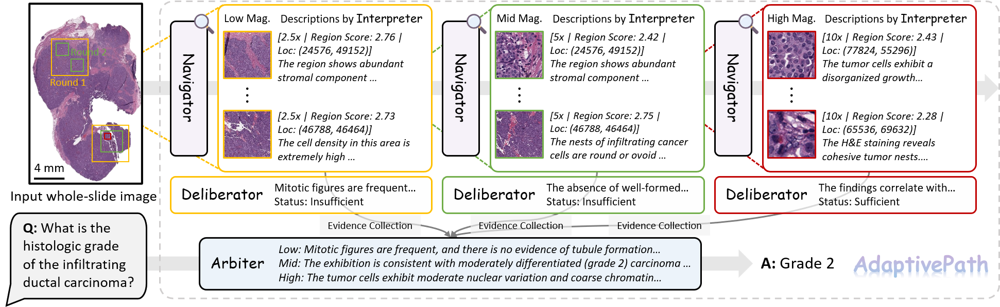
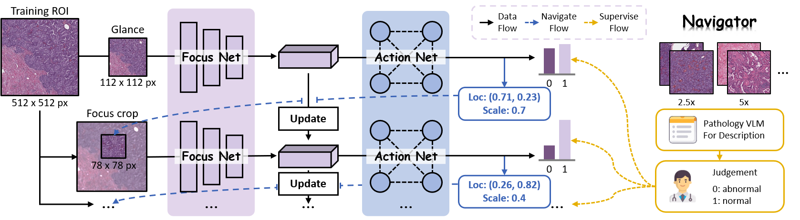

# Agentic Visual Reasoning in Whole-Slide Pathology Images via Active Perception

[](https://github.com/G14nTDo4/AdaptivePath)
[](https://arxiv.org/abs/2608.08648)
[](https://arxiv.org/abs/2608.08648.pdf)

<div align="center">

</div>

Official implementation of AdaptivePath, an active perception framework that formulates WSI evidence acquisition as a sequential
decision-making process. The source code is coming soon.

>Jingyun Chen, Fengchun Liu, Linghan Cai, Songhan Jiang, Shenjin Huang, Hongpeng Wang, Lequan Yu, Yongbing Zhang


Our main contributions are as follows:

1. We introduce AdaptivePath, an active-perception system for agentic WSI visual reasoning. The system integrates progressive navigation across magnifications, morphology interpretation conditioned on the question, evidence deliberation at each magnification, and final adjudication across magnifications into an explicit path from visual exploration to the final decision.
2. We construct an abnormal-region recognition dataset with pathologist-reviewed labels and use it to train a Navigator that localizes abnormalities, estimates their spatial extents, and provides observations across multiple magnifications to the downstream reasoning modules.
3. We comprehensively evaluate AdaptivePath on pathology VQA, cancer subtype classification, a pathologist-centered diagnostic utility test, and navigation trajectory alignment, assessing its question-answering performance, generalization, diagnostic value, and navigation behavior.


<p align="center"><i>Overview of AdaptivePath</i></p>


<p align="center"><i>Overview of the active-perception Navigator.</i></p>

## Citation
```bibtex
@article{chen2026agenticvisualreasoningwholeslide,
  title={Agentic Visual Reasoning in Whole-Slide Pathology Images via Active Perception},
  author={Jingyun Chen and Fengchun Liu and Linghan Cai and Songhan Jiang and Shenjin Huang and Hongpeng Wang and Lequan Yu and Yongbing Zhang},
  journal={arXiv preprint arXiv:2608.08648},
  year={2026}
}
```